<div align="center">

<a href="https://github.com/ishandutta2007/Awesome-AI-Prompt-Templates-Developer-Boilerplates">
  
</a>

# 🤖 Awesome AI Prompt Templates & Developer Boilerplates 🚀

<p align="center">
  <a href="https://github.com/ishandutta2007/Awesome-Awesome-Awesome"></a><a href="https://discord.gg/jc4xtF58Ve"></a>
  <a href="https://github.com/ishandutta2007/Awesome-Awesome-Awesome"></a>
  <a href="https://opensource.org/licenses/MIT"></a>
  <a href="#-table-of-contents"></a>
  <a href="#-sector-overview--market-dynamics"></a>
  <a href="https://github.com/ishandutta2007"></a>
</p>

**A curated directory of battle-tested AI prompt templates, coding agent configurations (`CLAUDE.md`, `SKILL.md`, `.cursorrules`), full-stack AI starter boilerplates, LLM evaluation harnesses, and prompt management SaaS platforms.** 🎯

</div>

---

## 📑 Table of Contents

- [🌐 Sector Overview & Market Dynamics](#-sector-overview--market-dynamics)
- [☁️ SaaS & Hosted Prompt Management Platforms](#-saas--hosted-prompt-management-platforms)
- [🐙 Open-Source GitHub Projects](#-open-source-github-projects)
  - [1. 💬 f/awesome-chatgpt-prompts](#1--fawesome-chatgpt-prompts)
  - [2. 📐 github/spec-kit](#2--githubspec-kit)
  - [3. 🔍 x1xhlol/system-prompts-and-models-of-ai-tools](#3--x1xhlolsystem-prompts-and-models-of-ai-tools)
  - [4. 📚 dair-ai/Prompt-Engineering-Guide](#4--dair-aiprompt-engineering-guide)
  - [5. 📖 openai/openai-cookbook](#5--openaiopenai-cookbook)
  - [6. ⚡ fastapi/full-stack-fastapi-template](#6--fastapifull-stack-fastapi-template)
  - [7. 🧵 danielmiessler/fabric](#7--danielmiesslerfabric)
  - [8. 🖱️ PatrickJS/awesome-cursorrules](#8--patrickjsawesome-cursorrules)
  - [9. 🧠 stanfordnlp/dspy](#9--stanfordnlpdspy)
  - [10. 🪢 langfuse/langfuse](#10--langfuselangfuse)
  - [11. 🤖 davila7/claude-code-templates](#11--davila7claude-code-templates)
  - [12. 🛡️ promptfoo/promptfoo](#12--promptfoopromptfoo)
  - [13. 🧱 EveryInc/compound-engineering-plugin](#13--everyinccompound-engineering-plugin)
  - [14. 💬 vercel/ai-chatbot](#14--vercelai-chatbot)
  - [15. 🖋️ handlebars-lang/handlebars.js](#15--handlebars-langhandlebarsjs)
  - [16. 🔮 GoogleCloudPlatform/generative-ai](#16--googlecloudplatformgenerative-ai)
  - [17. 🐝 wasp-lang/open-saas](#17--wasp-langopen-saas)
  - [18. 🚀 nextjs/saas-starter](#18--nextjssaas-starter)
  - [19. 🐍 pallets/jinja](#19--palletsjinja)
  - [20. 💳 brexhq/prompt-engineering](#20--brexhqprompt-engineering)
  - [21. 📐 BoundaryML/baml](#21--boundarymlbaml)
  - [22. 🧪 Agenta-AI/agenta](#22--agenta-aiagenta)
  - [23. 🦜 hwchase17/langchain-hub](#23--hwchase17langchain-hub)
  - [24. 🦙 run-llama/create-llama](#24--run-llamacreate-llama)
  - [25. 🦥 alvinunreal/lazyskills](#25--alvinunreallazyskills)
  - [26. 🕸️ langchain-ai/new-langgraph-project](#26--langchain-ainew-langgraph-project)
- [🏛️ Key Architectural Components](#️-key-architectural-components)
- [📈 Star History](#-star-history)
- [💖 Support & Community](#-support--community)
- [🤝 How to Contribute](#-how-to-contribute)
- [⚖️ Disclaimer & License](#️-disclaimer--license)

---

## 🌐 Sector Overview & Market Dynamics

The global AI prompt engineering and prompt management tooling market is estimated at **$670M to $2.6B+**, growing rapidly at a CAGR exceeding **25%** toward a projected **$8B+ by 2032**. 📈

The sector exhibits **moderate fragmentation** at the tool and developer layer—spanned by hundreds of specialized open-source CLI tools, agent skill registries, and niche prompt repositories—while simultaneously experiencing **accelerating concentration and platform aggregation** as enterprise observability platforms, model labs, and hyperscalers (Azure AI Foundry, AWS Bedrock, OpenAI) aggressively bundle prompt registries, evaluations, and CI/CD pipelines into unified LLMOps suites. 🏢

---

## ☁️ SaaS & Hosted Prompt Management Platforms

Commercial prompt engineering studios, prompt registries (CMS), marketplaces, and enterprise prompt optimization platforms. Sorted descending by company valuation / scale / funding. 📊

| Platform | Company Scale / Valuation / Funding | Starting Tier Pricing | Free Tier Limits / Evaluation Period | Core Capabilities |
| :--- | :--- | :--- | :--- | :--- |
| **[FlowGPT](https://flowgpt.com)** | **~$250M–$500M+ valuation** ($70M total funding, ~$45M ARR under Kaon AI) | $14.99/month (Plus tier) | Free forever with standard LLM chat models (Ares), baseline conversational memory, and unlimited public prompt browsing (no Flux bonus generation credits). | Interactive prompt sharing community, multi-turn AI character playground, and bot marketplace across GPT, Claude, and open weights. |
| **[PromptPerfect (Jina AI)](https://jina.ai)** | **$43.3M acquisition exit** (Acquired by Elastic in 2025; raised $39M prior) | $9.50/month (Standard tier) | Free tier allows 3 prompt optimizations/day on web or 1–3 daily perfect runs via the browser extension (standalone web sunset September 2026 into Elastic core). | Automated multi-model prompt optimizer, compressor, and translation engine across major LLMs and image diffusion models. |
| **[PromptLayer](https://promptlayer.com)** | **$4.8M Seed funding** (backed by ScOp, Stellation, OpenAI & Anthropic angels; ~$1M ARR) | $49.00/month (Pro tier) | Free forever for up to 2,500 requests/month, 10 registered prompts, and 250 evaluation cell executions. | Enterprise prompt CMS, Git-like prompt versioning, visual regression playground, and LLM observability trace linking. |
| **[AIPRM](https://aiprm.com)** | **Profitable / Bootstrapped** (High-margin browser SaaS; nominal <$300k early capital) | $20.00/month (Plus tier; Pro at $39/mo) | Free forever with community prompt library access and 2 private prompt slots inside ChatGPT and Claude extensions. | Browser-native prompt management suite with 4,000+ curated marketing, SEO, copywriting, and coding prompt templates. |
| **[PromptBase](https://promptbase.com)** | **Bootstrapped / Profitable** (Top creator marketplace taking 20% commission) | $19.00/month ($14 1st-mo promo on PromptBase Select, or $1.99–$9.99/prompt a la carte) | Free forever account to browse catalog, claim free community prompt listings, and register as a creator/seller. | Commercial prompt marketplace to buy and sell engineered prompt templates for Midjourney, FLUX, ChatGPT, Claude, and Veo. |
| **[PromptHero](https://prompthero.com)** | **Acquired / Lean Startup** (Self-funded community exit, multimillion monthly visits) | $19.00/month (Starter tier; Pro at $29/mo) | Free forever for public prompt discovery and personal-use generations with standard generation speed and public logs. | Visual prompt search engine and community repository for Stable Diffusion, Midjourney, FLUX, and LLM prompting styles. |
| **[PromptHub](https://prompthub.us)** | **Seed-stage / Angel funded** (Collaborative prompt Git platform) | $9.00/month (Pro tier; Team at $20/seat/mo) | Free forever for 1 user seat, up to 2,000 requests/month, unlimited public prompts, and ~10 prompt enhancements/month (no batch evaluations). | Collaborative prompt management platform built like GitHub for prompts—featuring branching, side-by-side model diffs, and team approvals. |
| **[Learn Prompting](https://learnprompting.org)** | **Self-funded / EdTech Startup** (Global community course backed by industry sponsors) | $21.00/month (Plus/Pro, billed annually; Teams at $25/seat/mo) | Free forever access to introductory curriculum (*ChatGPT for Everyone*, basic prompting guides) plus 3-day to 7-day free trial on select Pro courses. | Comprehensive prompt engineering courseware, agent architecture training, prompt hacking certifications, and in-browser tutor playground. |
| **[ChatX](https://chatx.ai)** | **Bootstrapped** (Micro-SaaS prompt hub) | $9.90/month (or pay-as-you-go token packs from $5.00) | Free forever with 15,000 free tokens daily upon account sign-up, plus no-login public testing on lightweight models. | Multi-model prompt playground, categorized prompt repository, and token-based prompt testing workbench for generative text and image generation. |
| **[Snack Prompt](https://snackprompt.com)** | **Bootstrapped** (Community-driven platform) | Free / Creator a la carte tips ($2.00–$10.00 creator-set pricing on premium workflows) | Free forever with full community prompt search, upvoting, custom bookmarking, and Chrome extension snippet runner. | Social prompt discovery feed, trending daily prompt upvotes, and browser extensions to inject community prompts into ChatGPT. |

---

## 🐙 Open-Source GitHub Projects

Curated open-source prompt libraries, coding agent instructions (`CLAUDE.md`, `.cursorrules`), full-stack AI templates, and algorithmic prompt optimizers. 

Sorted descending by current GitHub_Stars_Count. ⭐

### 1. 💬 f/awesome-chatgpt-prompts
[](https://github.com/f/awesome-chatgpt-prompts/stargazers) • `CC0-1.0`  
The definitive open-source community repository of role-playing, coding, writing, and system prompt templates adapted across ChatGPT, Claude, and local LLMs. Includes self-hostable community web interfaces and desktop apps.

### 2. 📐 github/spec-kit
[](https://github.com/github/spec-kit/stargazers) • `MIT`  
GitHub's official toolkit and structured prompt framework for Specification-Driven Development (SDD), providing iterative `Specify -> Plan -> Implement` prompt workflows for coding assistants.

### 3. 🔍 x1xhlol/system-prompts-and-models-of-ai-tools
[](https://github.com/x1xhlol/system-prompts-and-models-of-ai-tools/stargazers) • `GPL-3.0`  
Extensive reference archive tracking leaked and decompiled production system prompts, internal tool schemas, and behavioral templates from Cursor, Claude Code, Windsurf, Devin, v0, Lovable, Manus, and Replit.

### 4. 📚 dair-ai/Prompt-Engineering-Guide
[](https://github.com/dair-ai/Prompt-Engineering-Guide/stargazers) • `MIT`  
Comprehensive educational guide, research paper repository, and practical prompt engineering handbook covering Zero-Shot, Few-Shot, Chain-of-Thought (CoT), Directional Stimulus, ReAct, and Tree-of-Thoughts prompting.

### 5. 📖 openai/openai-cookbook
[](https://github.com/openai/openai-cookbook/stargazers) • `MIT`  
Official OpenAI repository of code examples, structured prompt engineering patterns, function calling templates, embeddings recipes, and production task workflows.

### 6. ⚡ fastapi/full-stack-fastapi-template
[](https://github.com/fastapi/full-stack-fastapi-template/stargazers) • `MIT`  
Production-ready Python FastAPI + React + PostgreSQL + Docker Compose boilerplate. Serves as the premier enterprise foundation for custom AI agent backends, async task queues (Celery/ARQ), and RAG APIs.

### 7. 🧵 danielmiessler/fabric
[](https://github.com/danielmiessler/fabric/stargazers) • `MIT`  
Crowdsourced modular framework and CLI of Markdown prompt "Patterns". Designed for piping Unix stdout/stdin through composable prompt templates for code review, threat modeling, technical writing, and summarization.

### 8. 🖱️ PatrickJS/awesome-cursorrules
[](https://github.com/PatrickJS/awesome-cursorrules/stargazers) • `CC0-1.0`  
Curated collection of framework-specific `.cursorrules` and AI IDE instructions for Next.js, Python, Rust, React, Tailwind, TypeScript, Go, and Flutter repositories.

### 9. 🧠 stanfordnlp/dspy
[](https://github.com/stanfordnlp/dspy/stargazers) • `MIT`  
Stanford NLP's groundbreaking framework that replaces fragile manual prompt templates with declarative Python signatures, teleprompters, and algorithmic prompt optimizers (MIPROv2, BootstrapFewShot).

### 10. 🪢 langfuse/langfuse
[](https://github.com/langfuse/langfuse/stargazers) • `MIT / FSL-1.1-MIT`  
Open-source LLM engineering platform featuring a decoupled Prompt CMS with environment promotion labels (`production`, `staging`), composable prompt templates, LLM observability, and automated evaluations.

### 11. 🤖 davila7/claude-code-templates
[](https://github.com/davila7/claude-code-templates/stargazers) • `MIT`  
Open-source CLI and template registry providing pre-configured `CLAUDE.md` templates, custom slash commands, autonomous agents, Model Context Protocol (MCP) server configs, and hooks for Claude Code workflows.

### 12. 🛡️ promptfoo/promptfoo
[](https://github.com/promptfoo/promptfoo/stargazers) • `MIT`  
Battle-tested CLI and testing harness for evaluating prompt templates against test fixtures, measuring hallucination rates, running automated AI red-teaming, and preventing regressions in CI/CD pipelines.

### 13. 🧱 EveryInc/compound-engineering-plugin
[](https://github.com/EveryInc/compound-engineering-plugin/stargazers) • `MIT`  
Compound engineering prompt plugin and methodology for Claude Code, Cursor, and Codex, transforming single-prompt code generation into multi-stage structured architecture review and self-healing test cycles.

### 14. 💬 vercel/ai-chatbot
[](https://github.com/vercel/ai-chatbot/stargazers) • `Apache-2.0`  
Full-stack Next.js AI chatbot boilerplate developed by Vercel. Incorporates the Vercel AI SDK, streaming Generative UI, Auth.js, Postgres (Drizzle ORM), multi-modal attachments, and interactive Artifacts canvas.

### 15. 🖋️ handlebars-lang/handlebars.js
[](https://github.com/handlebars-lang/handlebars.js/stargazers) • `MIT`  
Logic-less templating engine widely used in production prompt management pipelines to securely inject dynamic variables, conversation context, and few-shot examples into LLM prompts without arbitrary code execution risk.

### 16. 🔮 GoogleCloudPlatform/generative-ai
[](https://github.com/GoogleCloudPlatform/generative-ai/stargazers) • `Apache-2.0`  
Official Google Cloud repository containing Gemini prompt templates, Vertex AI multimodal recipes, function-calling patterns, and production reasoning prompt examples.

### 17. 🐝 wasp-lang/open-saas
[](https://github.com/wasp-lang/open-saas/stargazers) • `MIT`  
100% free open-source React + Node.js + Prisma full-stack SaaS boilerplate featuring Stripe/Polar billing, authentication, background worker jobs, and tailored AI agent prompt instructions (`AGENTS.md`).

### 18. 🚀 nextjs/saas-starter
[](https://github.com/nextjs/saas-starter/stargazers) • `MIT`  
Modern full-stack SaaS starter boilerplate from Next.js featuring Stripe subscription billing, PostgreSQL (Supabase/Neon), Auth, shadcn/ui components, and clean routes ready for rapid AI wrapper development.

### 19. 🐍 pallets/jinja
[](https://github.com/pallets/jinja/stargazers) • `BSD-3-Clause`  
Fast, expressive, and extensible Python templating engine. The foundational engine powering dynamic prompt variable interpolation, conditional prompt branches, and macro formatting across LangChain, LlamaIndex, and Hugging Face.

### 20. 💳 brexhq/prompt-engineering
[](https://github.com/brexhq/prompt-engineering/stargazers) • `MIT`  
Brex's production-grade prompt engineering guidebook detailing practical prompt engineering techniques, defensive prompting, context caching strategies, and evaluation heuristics learned while building AI financial agents.

### 21. 📐 BoundaryML/baml
[](https://github.com/BoundaryML/baml/stargazers) • `Apache-2.0`  
Domain-specific programming language for AI prompt engineering that turns LLMs into type-safe functions with guaranteed schema enforcement (Pydantic/TypeScript), visual playgrounds, and live streaming parsers.

### 22. 🧪 Agenta-AI/agenta
[](https://github.com/Agenta-AI/agenta/stargazers) • `Apache-2.0`  
Open-source developer-first LLMOps platform providing a collaborative prompt playground, versioned prompt registry, automated custom evaluation metrics, and one-click API deployment.

### 23. 🦜 hwchase17/langchain-hub
[](https://github.com/hwchase17/langchain-hub/stargazers) • `MIT`  
Open-source repository of reusable prompt templates, multi-turn reasoning chains, and agent instructions built for programmatic ingestion into LangChain and LangGraph runtimes.

### 24. 🦙 run-llama/create-llama
[](https://github.com/run-llama/create-llama/stargazers) • `MIT`  
Official CLI scaffolding tool from LlamaIndex that creates full-stack Next.js, Express, or FastAPI Retrieval-Augmented Generation (RAG) applications and multi-modal agent backends in seconds.

### 25. 🦥 alvinunreal/lazyskills
[](https://github.com/alvinunreal/lazyskills/stargazers) • `MIT`  
Terminal TUI manager and mission control utility for discovering, installing, syncing, and organizing reusable `SKILL.md` prompt capability files across local AI developer workspaces.

### 26. 🕸️ langchain-ai/new-langgraph-project
[](https://github.com/langchain-ai/new-langgraph-project/stargazers) • `MIT`  
Official starter boilerplate for building stateful multi-agent architectures, human-in-the-loop workflows, and long-term memory assistants with LangGraph, LangGraph Studio, and LangGraph Cloud.

---

## 🏛️ Key Architectural Components

When evaluating tools for building production LLM applications, consider the core layers of modern AI prompt engineering:

```
┌─────────────────────────────────────────────────────────────┐
│                   Application Layer                         │
│  Next.js AI Chatbot / Full-Stack FastAPI / Open SaaS Boilerplate
└──────────────────────────────┬──────────────────────────────┘
                               │
┌──────────────────────────────▼──────────────────────────────┐
│             Agent Configs & Instruction Rules               │
│     CLAUDE.md  │  SKILL.md  │  .cursorrules  │  Spec-Kit    │
└──────────────────────────────┬──────────────────────────────┘
                               │
┌──────────────────────────────▼──────────────────────────────┐
│            Prompt CMS, Templating & Compilation             │
│    Langfuse / PromptLayer / PromptHub / Jinja2 / BAML       │
└──────────────────────────────┬──────────────────────────────┘
                               │
┌──────────────────────────────▼──────────────────────────────┐
│           Optimization, Evaluation & Red-Teaming            │
│         DSPy (MIPROv2)  │  Promptfoo  │  Agenta             │
└─────────────────────────────────────────────────────────────┘
```

1. **System & Agent Instruction Files**: Persistent project context files (`CLAUDE.md`, `.cursorrules`, `SKILL.md`, `AGENTS.md`) that guide AI coding agents on repository conventions, dependencies, lint rules, and build scripts. 📑
2. **Deterministic Schemas & Templating**: Prompt templating languages (`Jinja2`, `Handlebars`, `BAML`) that enforce dynamic parameter injection and type-safe JSON schema output guarantees. 🧩
3. **Automated Prompt Compilers**: Algorithmic optimizers like `DSPy` that automatically synthesize, tune, and select few-shot demonstrations based on quantitative loss functions rather than manual trial-and-error. ⚙️
4. **CI/CD Quality Gates & Security**: Automated evaluation runners like `promptfoo` that run prompt suites against evaluation datasets, catch regressions, and conduct security red-teaming (jailbreaks, prompt injection, data extraction). 🔒

---

## 📈 Star History

[](https://www.star-history.com/#ishandutta2007/Awesome-AI-Prompt-Templates-Developer-Boilerplates&type=date&legend=top-left)

---

## 💖 Support & Community

Thank you so much for exploring and supporting this curated resource! 🙏 If you find this repository helpful for your projects, workflows, or research:

- ⭐ **Star** this repository on GitHub to show your appreciation and help others discover it.
- 🍴 **Fork** it to build your own custom agent workflows or submit new tools.
- 📢 **Share** it with fellow AI engineers, prompt architects, and full-stack builders on Twitter/X, LinkedIn, or Discord.
- ☕ **Buy Me a Coffee**: If you'd like to support ongoing maintenance and new ecosystem tracking, visit the [GitHub Sponsor Dashboard](https://github.com/sponsors/ishandutta2007). Your support is deeply appreciated! ✨

---

## 🤝 How to Contribute

Contributions are welcome and greatly appreciated! Help keep this ecosystem guide comprehensive and accurate:

1. 🍴 Fork the repository.
2. 🌿 Create a descriptive feature branch (`git checkout -b add-my-prompt-tool`).
3. 📝 Add your entry to the appropriate section:
   - For **SaaS platforms**, ensure tabular format with specific starting pricing, explicit free tier limits, and verifiable company scale/valuation.
   - For **Open-source projects**, provide the repo link, exact license, a linked stargazers badge (`https://img.shields.io/github/stars/<owner>/<repo>?style=social&color=white`), and place it according to its star ranking.
4. 🔍 Keep entries objective, factual, and verifiable.
5. 🚀 Commit your changes (`git commit -m 'Add <project-name>'`) and open a Pull Request.

---

## ⚖️ Disclaimer & License

Distributed under the MIT License. See [LICENSE](file:///C:/Users/ishan/Documents/Projects/Awesome-AI-Prompt-Templates-Developer-Boilerplates/LICENSE) for more information.

All product names, logos, and brands are property of their respective owners. Mention in this repository does not imply endorsement.
